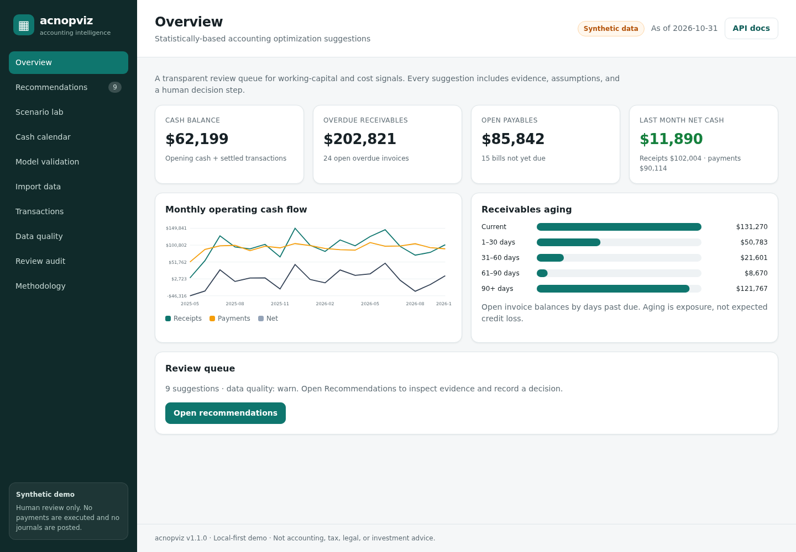

# acnopviz

**Statistically-based accounting optimization suggestions (explainable, local-first, human-reviewed).**

acnopviz turns a synthetic accounting ledger into a prioritized review queue and liquidity decision support: overdue receivables, duplicate-payment candidates, early-payment discounts, expense drift, historical liquidity stress tests, a committed AR/AP cash calendar, walk-forward model validation, and validated CSV-bundle import. It never executes payments or posts journal entries.

> **Status:** v1.1.0 demo on synthetic data. Not accounting, tax, legal, or investment advice. Production use requires real-data validation, accounting policy review, authentication/authorization, and security hardening.



## Features

- **Dashboard:** cash, overdue AR, open AP, monthly cash flow, receivables aging.
- **Recommendations:** Wilson-interval collection signals, exact duplicate controls, discount-vs-financing math, Theil-Sen/Kendall/Holm expense drift, block-bootstrap liquidity.
- **Scenario lab:** financing APR, one-time overdue recovery uplift, recurring expense reduction, 1-12 month horizon.
- **Cash calendar (v1.1):** committed runoff forecast scheduling open AR/AP, empirical collection-delay draws, and recurring overhead resampled without double counting linked settlements.
- **Model validation (v1.1):** expanding-window walk-forward backtest with MAE/RMSE/bias/P10-P90 coverage and a naive benchmark.
- **Import data (v1.1):** dry-run validation, strict CSV/schema/reconciliation checks, fingerprinted atomic replacement, explicit confirmation, audit event.
- **Review workflow:** accept/dismiss/new with notes, persisted in SQLite and appended to an audit trail.
- **Data browser & exports:** searchable AR/AP/cash ledger, CSV exports with spreadsheet formula-injection protection.
- **API docs:** OpenAPI/Swagger at `/docs`.

## Quick start

Requires Python 3.11+.

```bash
python -m venv .venv
source .venv/bin/activate        # Windows: .venv\Scripts\activate
pip install -e ".[dev]"

# Generate deterministic synthetic CSVs + SQLite database
acnopviz seed --replace

# Optional: regenerate v1.1 improvement fixtures
python scripts/generate_improvement_fixtures.py

# Run the app
acnopviz serve --host 0.0.0.0 --port 8000
```

Open <http://localhost:8000>. API docs: <http://localhost:8000/docs>.

### Docker

```bash
docker compose up --build
# http://localhost:8000
```

## CLI

```bash
acnopviz seed --seed 20261104 --as-of 2026-10-31 --db data/acnopviz.db --csv-dir data/synthetic --replace
acnopviz report --db data/acnopviz.db
acnopviz serve --host 0.0.0.0 --port 8000
```

Environment variables: `ACNOPVIZ_DB`, `ACNOPVIZ_SEED`, `ACNOPVIZ_AS_OF`, `ACNOPVIZ_HOST`, `ACNOPVIZ_PORT`, `ACNOPVIZ_BOOTSTRAP_PATHS`, `ACNOPVIZ_BOOTSTRAP_BLOCK`.

## New v1.1 API endpoints

- `GET /api/cash-calendar?horizon=6`
- `GET /api/backtest?horizon=3&min_train=9`
- `GET /api/import/template`
- `POST /api/import/validate`
- `POST /api/import/commit` (requires `confirm: "REPLACE"` and validation fingerprint)

## Testing

```bash
python -m playwright install chromium
python -m ruff check src tests
python -m ruff format --check src tests
python -m pytest --cov=acnopviz --cov-report=term-missing
python -m pytest -m e2e          # browser tests only
python -m pip_audit              # dependency audit (network required)
```

See [`docs/TEST_REPORT.md`](docs/TEST_REPORT.md) for executed results and known limitations.

## Project layout

```text
src/acnopviz/
  analysis/        statistics, recommendations, cash calendar, backtest
  static/          dependency-free dashboard (HTML/CSS/JS)
  api.py           FastAPI boundary
  ingest.py        CSV bundle validation
  storage.py       SQLite persistence + atomic import + audit
  synthetic.py     deterministic demo ledger generator
  cli.py           seed / report / serve
scripts/           improvement fixture generator
tests/             unit, integration, Playwright E2E
data/synthetic/    generated CSVs, manifest, v1.1 improvement fixtures
docs/              research, plans, requirements, methodology, data dictionary, security, test report
```

## Documentation

- [v1.1 improvement research](docs/IMPROVEMENT_RESEARCH.md)
- [v1.1 improvement plan](docs/IMPROVEMENT_PLAN.md)
- [v1.1 improvement requirements](docs/IMPROVEMENT_REQUIREMENTS.md)
- [Original research](docs/RESEARCH.md), [development plan](docs/DEVELOPMENT_PLAN.md), [requirements](docs/REQUIREMENTS.md)
- [Methodology](docs/METHODOLOGY.md), [data dictionary](docs/DATA_DICTIONARY.md), [security](docs/SECURITY.md), [test report](docs/TEST_REPORT.md)
- [Changelog](CHANGELOG.md)

## Key limitations

- Synthetic data only; no empirical accuracy claim on real businesses.
- The cash calendar is a **runoff** forecast: it schedules open AR/AP but does not create new sales/purchases.
- Backtest folds overlap and are synthetic-only; coverage is diagnostic, not a guarantee.
- Duplicate matches are review candidates, not proof of fraud or error.
- Local demo has no authentication/authorization or tenant isolation. Do not expose it publicly with real data.

## License

MIT see [LICENSE](LICENSE).
